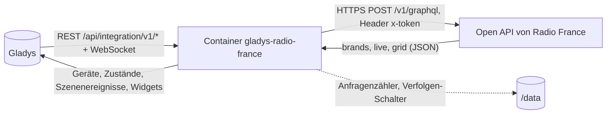
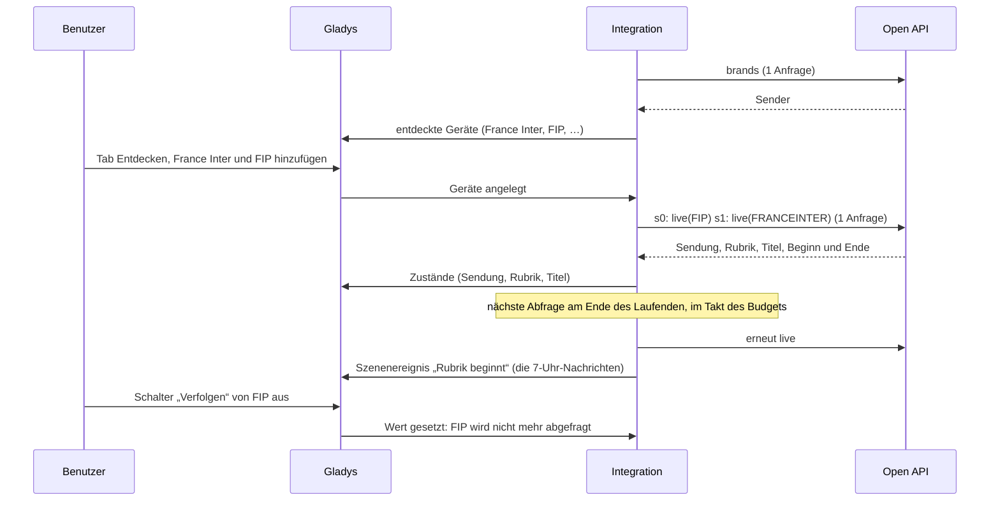
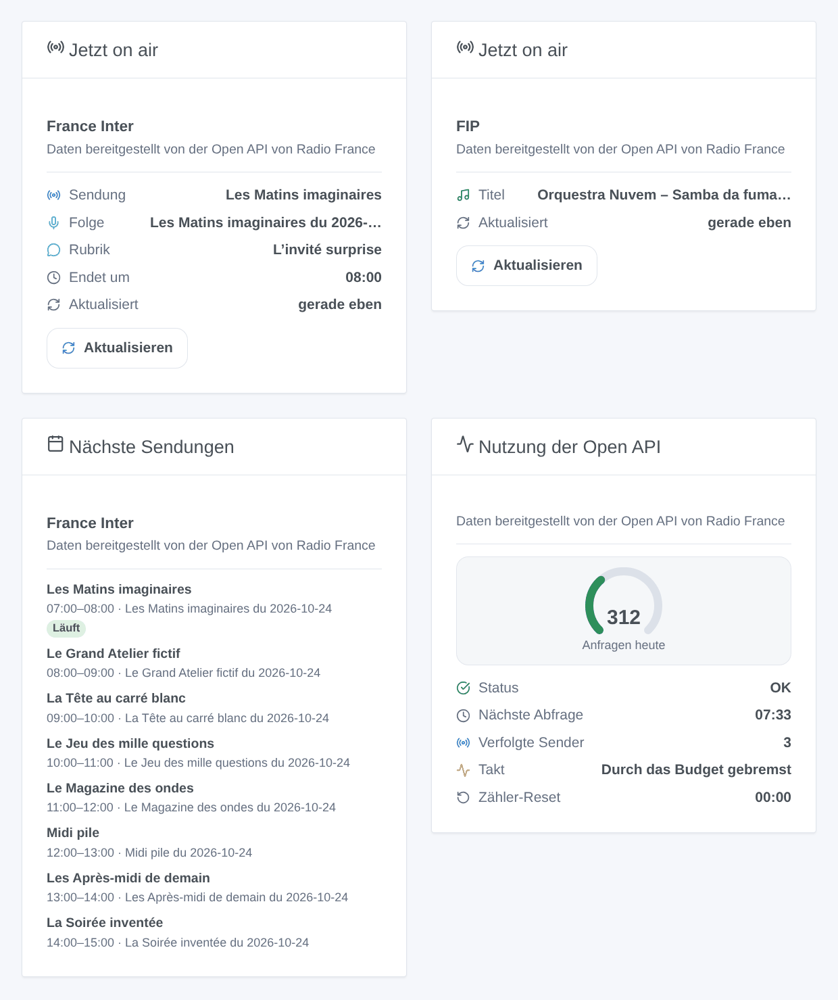

# Gladys Radio France

[English](README.md) · [Français](README.fr.md) · **Deutsch** · [Español](README.es.md)

[](LICENSE)
[](https://github.com/William-De71/gladys-radio-france/releases)
[](https://github.com/William-De71/gladys-radio-france/actions/workflows/release.yml)
[](https://gladysassistant.com)


Externe Integration für [Gladys Assistant](https://gladysassistant.com) für die Sender von **Radio France**: Sendung, Rubrik und Titel, die gerade auf France Inter, franceinfo, France Culture, France Musique, FIP, Mouv’, den Lokalsendern ICI und den Webradios laufen, aus der offiziellen Open API mit deinem eigenen Schlüssel. Deine Szenen reagieren, wenn eine neue Sendung, Rubrik oder ein neuer Titel beginnt, und dein Dashboard zeigt, was läuft und was als Nächstes kommt.

Benutzerdokumentation: [English](docs/en.md) · [Français](docs/fr.md) · [Deutsch](docs/de.md) · [Español](docs/es.md).

**Inoffizielle Integration, ohne Verbindung zu Radio France.** Daten bereitgestellt von der Open API von Radio France („données fournies par l’Open API Radio France“). **Noch nicht mit einem echten Schlüssel getestet**: Beim Schreiben hatte niemand einen; der Client wird gegen eine nachgebaute API getestet, die auf der Dokumentation und auf Projekten beruht, die die API nutzen.

## Funktionen

- **Die Senderliste kommt aus der API** (keine Liste im Code): nationale Sender, Webradios, Lokalsender ICI (früher France Bleu).
- **Ein Gerät pro Sender**: Sendung, Rubrik und Titel, die gerade laufen (Text), und ein Schalter **Verfolgen**: Nur verfolgte Sender werden abgefragt.
- **Innerhalb des Kontingents**: bis zu 10 Sender pro Anfrage, die nächste Abfrage, wenn das Laufende endet, ein Tagesbudget (standardmäßig 900 der 1.000 Anfragen eines Schlüssels), über den Tag verteilt, eine Pause bis Mitternacht (Paris), wenn das Kontingent erreicht ist.
- **3 Szenenauslöser** (neuer Titel, Sendung beginnt, Rubrik beginnt), **2 Szenenaktionen** (was gerade läuft, nächste Sendungen mit einem Satz zum Vorlesen) und **3 Dashboard-Widgets** (jetzt on air mit Schaltfläche Aktualisieren, nächste Sendungen, Nutzung der Open API).
- Hält die Bedingungen der Open API ein: nichts von Radio France gespeichert, kein Stream abgespielt, kein Logo, der Hinweis in jedem Widget.
- Überall vier Sprachen: Englisch, Französisch, Deutsch, Spanisch.

## Funktionsweise




Von der Senderliste bis zur Szene:



### Transport

`transports: ["cloud"]`: Alles geht an `https://openapi.radiofrance.fr/v1/graphql`, mit deinem Schlüssel im Header `x-token` (nie in der URL, nie in den Logs). Die Anfragen verraten Radio France, welche Sender du verfolgst und wann. `/data` enthält nur den Anfragenzähler des Tages und die Verfolgen-Schalter; Senderliste, laufendes Programm und Raster bleiben im Arbeitsspeicher (höchstens eine Stunde), wie es die Bedingungen der Open API verlangen.

## Geräte und Funktionen

| Funktion  | Gladys-Typ    | Hinweise                                                                                       |
| --------- | ------------- | ---------------------------------------------------------------------------------------------- |
| Sendung   | text          | Name der laufenden Sendung; ein Strich, wenn es keine gibt (vor allem FIP und seine Webradios) |
| Rubrik    | text          | die Rubrik in der Sendung (Nachrichten, Kolumne, Interview); ein Strich dazwischen             |
| Titel     | text          | „Interpret – Titel“ auf den Musiksendern; sonst ein Strich                                     |
| Verfolgen | switch/binary | standardmäßig an; aus = der Sender wird nie abgefragt; Szenen können ihn schalten              |

Externe IDs: `ext:<selector>:station:<Sender-ID in Kleinbuchstaben>` (`fip`, `franceinter`, `francebleu_alsace`…), aus der `StationsEnum`-ID der API, nie aus dem Titel.

## Szenenauslöser, Aktionen und Widgets



Die Bilder sind **generierte Illustrationen**, vom echten Widget-Code aus erfundenen Sendungen gezeichnet, keine Screenshots.

**Widgets**: **Jetzt on air** (Sendung, Folge, Rubrik, Titel, Ende, letzte Abfrage; Schaltfläche **Aktualisieren**, eine Anfrage, höchstens einmal pro Minute), **Nächste Sendungen** (die nächsten Sendungen aus dem Programmraster, höchstens alle 15 Minuten gelesen), **Nutzung der Open API** (Anzeige der heutigen Anfragen, Status, nächste Abfrage, verfolgte Sender, Reset-Zeit).

**Szenenauslöser** für verfolgte Sender, einmal pro neuem Abschnitt, nie bei der ersten Abfrage nach einem Start, nie für einen Abschnitt, der vor mehr als 30 Minuten begann, nie wegen einer Szenenaktion oder einer Schaltfläche:

| Auslöser                      | Filter | Variablen                                                      |
| ----------------------------- | ------ | -------------------------------------------------------------- |
| Radio France: neuer Titel     | Sender | Sender, Sendername, Titel, Interpret, Album, Jahr, Label       |
| Radio France: Sendung beginnt | Sender | Sender, Sendername, Sendung, Titel, Zusammenfassung, URL, Ende |
| Radio France: Rubrik beginnt  | Sender | dieselben wie „Sendung beginnt“                                |

**Szenenaktionen**:

| Aktion                          | Felder                    | Ausgaben                                                  |
| ------------------------------- | ------------------------- | --------------------------------------------------------- |
| Radio France: was gerade läuft  | Sender                    | Sendung, Rubrik, Titel des Stücks, Interpret, Album, Ende |
| Radio France: nächste Sendungen | Sender, Anzahl (1 bis 10) | Satz zum Vorlesen, nächste Sendung, ihre Startzeit        |

Beispiele:

- **Rubrik beginnt** auf France Inter, Sendung „Le journal de 7h“ → den Küchenlautsprecher lauter stellen.
- **Neuer Titel** auf FIP → Titel und Interpret als Benachrichtigung an den Fernseher senden.
- **Jeden Tag um 19 Uhr** → „nächste Sendungen“ auf France Culture, dann den Satz vorlesen.

## Voraussetzungen

- Gladys Assistant **5.1.0** oder neuer (Dashboard-Widgets und Szenenauslöser / -aktionen): Ältere Instanzen können die Integration nicht installieren.
- Internetzugang von Gladys aus.

### Dein Open-API-Schlüssel

Jeder Benutzer braucht einen eigenen Schlüssel, kostenlos, persönlich und nicht übertragbar: Lege ein Konto auf [developers.radiofrance.fr](https://developers.radiofrance.fr) an, dann **Mein Konto → API-Schlüssel beantragen** mit Namen und Zweck deines Projekts. Radio France prüft jeden Antrag von Hand und schickt den Schlüssel per E-Mail, oft am selben Tag.

## Kontingent und Nutzungsbedingungen

- **1.000 Anfragen pro Tag und Schlüssel** (Nutzungsbedingungen, Art. 5.3 und 9.1): Darüber sperrt Radio France den Schlüssel. Die Integration erlaubt sich `daily_budget` (standardmäßig 900), zählt jede HTTP-Anfrage (Abfragen, Aktionen, Schaltfläche, Programm-Widget, Schlüsseltest, Senderliste), hält 5 % für Aktionen und Widgets zurück und pausiert bis Mitternacht (Paris), wenn das Budget aufgebraucht ist oder die API wegen des Kontingents ablehnt.
- Die Bedingungen definieren eine Anfrage als HTTP-Anfrage: Die Integration fragt bis zu 10 Sender in einer einzigen ab (GraphQL-Aliase). Dass Radio France das als eine Anfrage zählt, ist eine Annahme, ebenso der Reset um Mitternacht Pariser Zeit.
- Keine Speicherung von Daten von Radio France (FAQ), keine Wiedergabe von Streams oder Podcasts (FAQ), keine kommerzielle Nutzung, Daten unverändert angezeigt (Titel werden nicht übersetzt; lange werden in den Widgets gekürzt), der Hinweis „données fournies par l’Open API Radio France“ in jedem Widget, kein Logo von Radio France (das Titelbild ist ein generisches Radio).

## Installation

- **Aus dem Store**: Integrationen → Radio France → Installieren.
- **Über die URL des Repositorys**: Integrationen → Von einer URL installieren → `https://github.com/William-De71/gladys-radio-france`.
- **Entwicklermodus**: Starte den Container selbst mit den Variablen, die Gladys anzeigt (siehe Entwicklung).

## Konfiguration

| Feld                      | Standard    | Bedeutung                                                                                     |
| ------------------------- | ----------- | --------------------------------------------------------------------------------------------- |
| Open-API-Schlüssel        | —           | Pflichtfeld, geheim                                                                           |
| Sprache der Texte         | Französisch | Funktionsnamen, Status, Sätze der Aktionen (Gladys teilt die Sprache des Benutzers nicht mit) |
| Tagesbudget (Anfragen)    | 900         | 100 bis 1.000; senke den Wert, wenn der Schlüssel noch anderes bedient                        |
| Mindestabstand (Sekunden) | 90          | 60 bis 600; nie zwei Abfragen in kürzerem Abstand                                             |

**API-Schlüssel testen** (Schaltfläche der Konfiguration) liest die Senderliste (eine Anfrage) und zeigt die heute verbrauchten Anfragen.

## Verwendung

1. Beantrage deinen Schlüssel auf developers.radiofrance.fr und warte auf die E-Mail.
2. Installiere die Integration, füge den Schlüssel ein, drücke **API-Schlüssel testen**.
3. **Entdecken**, dann die Sender hinzufügen, die du hörst; schalte **Verfolgen** bei denen aus, die du nur in einem Widget willst.
4. Füge die Widgets einem Dashboard hinzu; baue Szenen mit den Auslösern und Aktionen.

## Entwicklung

```bash
npm install
npm test                       # node --test, eine nachgebaute Open API, nie das Netzwerk
npm run lint                   # ESLint
npm run format:check           # Prettier
npx github:GladysAssistant/integration-store . --skip-image-check
node scripts/fake-openapi.mjs 8781     # eine nachgebaute Open API auf 127.0.0.1, Schlüssel test-key-0123456789
scripts/check-simulator.sh     # die echte Integration per HTTP gegen die nachgebaute API, 3 Schemaformen
scripts/build-cover.sh         # cover.jpg aus docs/assets/cover.svg
docs/illustrations/render.sh   # docs/assets/widgets.<sprache>.png
```

Lokal liest das SDK `GLADYS_HOST_API_URL`, `GLADYS_INTEGRATION_TOKEN` und `GLADYS_INTEGRATION_SELECTOR` (von Gladys im Entwicklermodus angezeigt); `RADIO_FRANCE_DATA_DIR` verlegt `/data`; `RADIO_FRANCE_OPENAPI_URL=http://127.0.0.1:8781/v1/graphql` lässt die Integration die nachgebaute API nutzen (nur eine lokale Adresse wird akzeptiert: Der Schlüssel geht nie woandershin). `DEBUG=gladys-integration-sdk` zeigt die Logs des SDK.

Die Tests decken den Client ab (Header `x-token`, Aliase, Sender-IDs, Fehler 401 / 429 / Kontingent / GraphQL / Netzwerk, der Schlüssel nie in einer Meldung), das Lesen der Antworten (Senderliste, Abschnitte, Sendungen eines Rasters), den Planer (Ende der Abschnitte, Unter- und Obergrenze, Takt des Budgets, Mitternacht in Paris mit Zeitumstellung), den Zähler in `/data`, die Auslöser (Übergänge, nicht bei der ersten Abfrage, veraltete Abschnitte), die Aktionen (nur deklarierte Ausgaben), die Widgets (`validateWidgetContent`), die Geräte, das Manifest, die vier Sprachen, das Release-Skript und die ganze Integration gegen das nachgebaute Gladys des SDK und die nachgebaute API. `test/structure.test.js` friert alle Schlüssel ein, die Benutzer speichern.

## Release-Prozess


Jeder Merge auf `main` startet die CI und berechnet dann die Version aus den [Conventional Commits](https://www.conventionalcommits.org/de/) seit dem letzten Tag: `feat` → Minor, `fix` / `perf` → Patch, `!` oder `BREAKING CHANGE` → Major (ein Minor unter 1.0.0); `docs`, `chore`, `ci`, `test`, `style`, `refactor`, `build` allein veröffentlichen nichts. Der Changelog-Abschnitt wird erzeugt, der Tag gepusht, das Multi-Architektur-Image gebaut, dann erhält `main` den Release-Commit, das GitHub-Release wird erstellt und ein letzter Job prüft das öffentliche Image, den Store-Validator und das Topic.

- Der Titel des Pull Requests wird zum Squash-Commit und dann zur Changelog-Zeile: Schreib ihn auf Englisch, für den Benutzer (`pr-title.yml` prüft ihn). Bearbeite `CHANGELOG.md` nie von Hand.
- 1.0.0 ist eine Entscheidung: Actions → Release → Run workflow mit `release-as: 1.0.0`. `dry-run` zeigt Version und Notizen, ohne etwas zu veröffentlichen.
- **Geschützter Branch**: Das Release pusht seinen Commit mit `GITHUB_TOKEN` auf `main`. Das Ruleset `protect-main` (kein Löschen, kein Force-Push) lässt ihn durch; eine strengere Regel (Pull Request Pflicht, Status-Checks) bräuchte GitHub Actions in ihrer Bypass-Liste oder eine GitHub App.
- Mach nach dem ersten Release das Paket auf `ghcr.io` öffentlich (Package settings → Change visibility), sonst kann Gladys es nicht laden.

## Fehlerbehebung

Siehe [docs/de.md](docs/de.md#fehlerbehebung). Melde Probleme mit den Versionen von Gladys und der Integration, der Meldung von **API-Schlüssel testen** (sie zeigt nie den Schlüssel), dem Widget „Nutzung der Open API“ und den Logs mit `DEBUG=gladys-integration-sdk`. Füge nie deinen Schlüssel ein.

## Mitwirken

Issues und Pull Requests sind willkommen. Führe `npm run format:check && npm run lint && npm test` aus, bevor du einen Pull Request öffnest, und lass alle externen IDs und gespeicherten Schlüssel unverändert (siehe [CLAUDE.md](CLAUDE.md)). Wenn du einen Schlüssel hast, hilft eine Antwort der echten `live`-Abfrage (gern mit erfundenen Titeln) mehr als alles andere: Das Schema lässt sich ohne Schlüssel nicht lesen.

## Sicherheit

Siehe [SECURITY.md](SECURITY.md): Melde Schwachstellen vertraulich. Der Schlüssel ist ein `secret`-Feld, wird nur an `openapi.radiofrance.fr` in einem Header gesendet, nie protokolliert und nie in `/data` geschrieben.

## Kommende Screenshots

Die Bilder oben sind Illustrationen, keine Screenshots. Echte Screenshots kommen nach `docs/assets/screenshots/` (PNG, 1280 × 800): `configuration.png` (der Schlüssel und die Hilfeabschnitte), `discovery.png` (die Senderliste), `device.png` (ein Sender mit seinen Funktionen auf einem Dashboard), `scene-trigger.png` (der Auslöser „Rubrik beginnt“), `scene-upcoming.png` (die Aktion „nächste Sendungen“ und ihr Satz).

## Bekannte Grenzen

- Nie mit einem echten Schlüssel getestet: das genaue Schema der `live`-Abfrage, die Zählung einer Anfrage mit Aliasen, die Reset-Zeit des Kontingents und die aktuellen IDs der ICI-Sender sind Annahmen (siehe CLAUDE.md). Lehnt die API die `live`-Abfrage ab, weicht die Integration auf einfachere Formen und dann auf das Programmraster aus.
- Auslöser kommen aus den regelmäßigen Abfragen: schlimmstenfalls einige Minuten verspätet, und ein Titel, der kürzer als der Abstand ist, kann verpasst werden.
- Kein Live-Hören, kein Podcast: Die Open API erlaubt es nicht.
- FIP und seine Webradios veröffentlichen ihr Programm nicht im Voraus.

## Lizenz

[Apache-Lizenz 2.0](LICENSE) — siehe auch [NOTICE](NOTICE). Radio France und die Namen seiner Sender gehören Radio France; dieses Projekt steht in keiner Verbindung dazu. Danke an die Dokumentation und das SDK von Gladys sowie an die Projekte, die die Open API mit Beispielen dokumentiert haben (siehe NOTICE).
