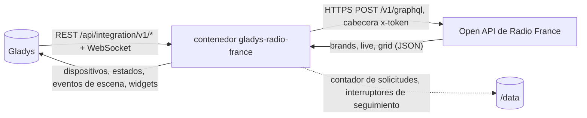
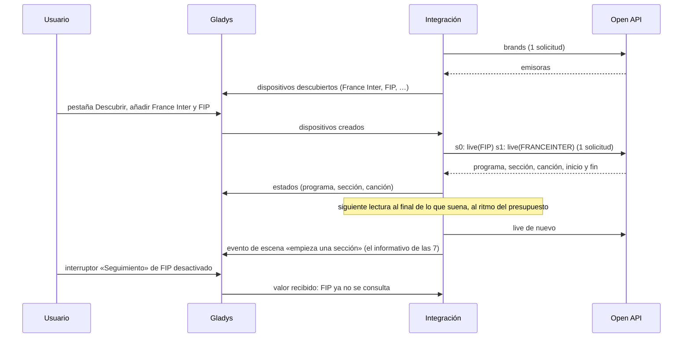
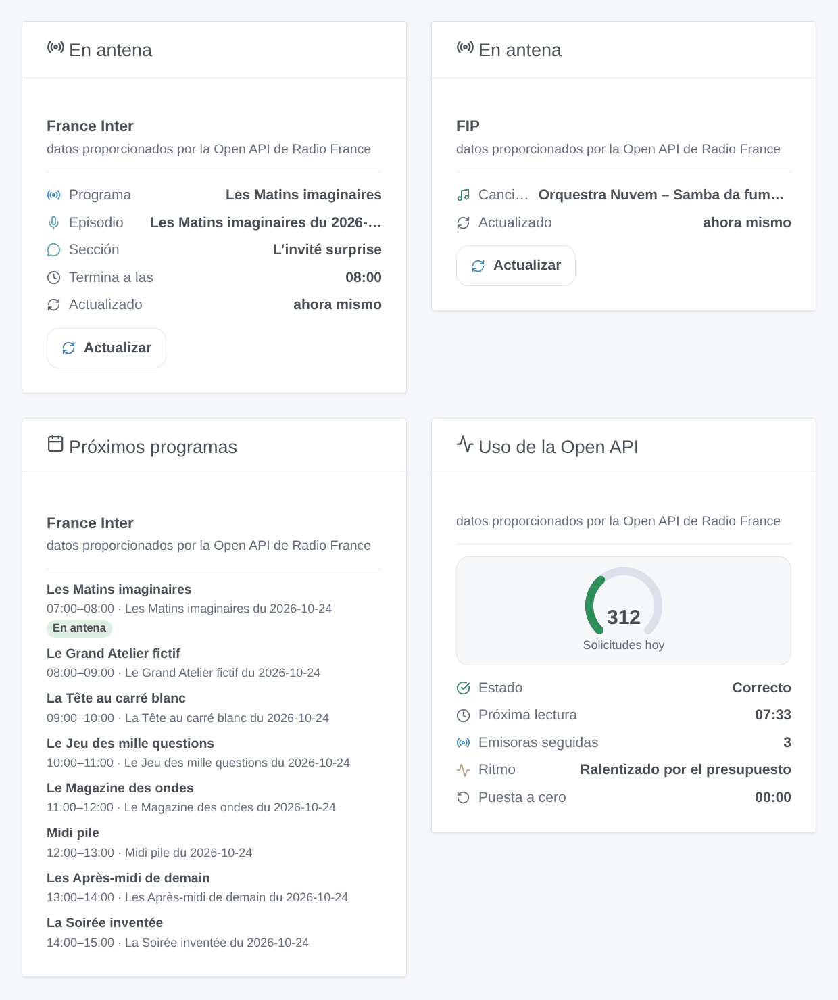

# Gladys Radio France

[English](README.md) · [Français](README.fr.md) · [Deutsch](README.de.md) · **Español**

[](LICENSE)
[](https://github.com/William-De71/gladys-radio-france/releases)
[](https://github.com/William-De71/gladys-radio-france/actions/workflows/release.yml)
[](https://gladysassistant.com)


Integración externa de [Gladys Assistant](https://gladysassistant.com) para las emisoras de **Radio France**: el programa, la sección y la canción en antena en France Inter, franceinfo, France Culture, France Musique, FIP, Mouv’, las emisoras locales ICI y las radios web, desde la Open API oficial con su propia clave. Sus escenas reaccionan cuando empieza un nuevo programa, una nueva sección o una nueva canción, y su panel muestra lo que suena y lo que viene.

Documentación de usuario: [English](docs/en.md) · [Français](docs/fr.md) · [Deutsch](docs/de.md) · [Español](docs/es.md).

**Integración no oficial, sin vínculo con Radio France.** Datos proporcionados por la Open API de Radio France («données fournies par l’Open API Radio France»). **Aún no probada con una clave real**: nadie tenía una al escribirla; el cliente se prueba contra una API simulada construida a partir de la documentación y de proyectos que usan la API.

## Funciones

- **La lista de emisoras viene de la API** (ninguna lista en el código): emisoras nacionales, radios web, emisoras locales ICI (antes France Bleu).
- **Un dispositivo por emisora**: programa, sección y canción en antena (texto), y un interruptor **Seguimiento**: solo se consultan las emisoras seguidas.
- **Dentro de la cuota**: hasta 10 emisoras por solicitud, la siguiente lectura cuando termina lo que suena, un presupuesto diario (por defecto 900 de las 1.000 solicitudes de una clave) repartido a lo largo del día, una pausa hasta medianoche (París) cuando se alcanza la cuota.
- **3 disparadores de escena** (nueva canción, empieza un programa, empieza una sección), **2 acciones de escena** (qué suena en antena, próximos programas con una frase para leer) y **3 widgets** (en antena con un botón Actualizar, próximos programas, uso de la Open API).
- Respeta las condiciones de la Open API: nada de Radio France almacenado, ningún flujo reproducido, ningún logotipo, el crédito en cada widget.
- Cuatro idiomas en todas partes: inglés, francés, alemán, español.

## Funcionamiento




De la lista de emisoras a una escena:



### Transporte

`transports: ["cloud"]`: todo va a `https://openapi.radiofrance.fr/v1/graphql` con su clave en la cabecera `x-token` (nunca en la URL, nunca en los registros). Las solicitudes revelan a Radio France qué emisoras sigue y cuándo. `/data` solo contiene el contador de solicitudes del día y los interruptores de seguimiento; la lista de emisoras, lo que suena y las parrillas se quedan en memoria (una hora como mucho), como exigen las condiciones de la Open API.

## Dispositivos y funciones

| Función     | Tipo Gladys   | Notas                                                                                          |
| ----------- | ------------- | ---------------------------------------------------------------------------------------------- |
| Programa    | text          | nombre del programa en antena; un guion si no hay ninguno (sobre todo FIP y sus radios web)    |
| Sección     | text          | la sección dentro del programa (informativo, columna, entrevista); un guion entre dos          |
| Canción     | text          | «Artista – Título» en las emisoras musicales; un guion en otro caso                            |
| Seguimiento | switch/binary | activado por defecto; desactivado = la emisora nunca se consulta; las escenas pueden cambiarlo |

Identificadores externos: `ext:<selector>:station:<id de la emisora en minúsculas>` (`fip`, `franceinter`, `francebleu_alsace`…), a partir del identificador `StationsEnum` de la API, nunca de su título.

## Disparadores, acciones de escena y widgets



Las imágenes son **ilustraciones generadas**, dibujadas por el código real de los widgets con programas inventados, no capturas de pantalla.

**Widgets**: **En antena** (programa, episodio, sección, canción, final, última lectura; botón **Actualizar**, una solicitud como mucho una vez por minuto), **Próximos programas** (los próximos programas según la parrilla, leída como mucho cada 15 minutos), **Uso de la Open API** (indicador de las solicitudes de hoy, estado, próxima lectura, emisoras seguidas, hora de puesta a cero).

**Disparadores de escena**, para las emisoras seguidas, una vez por nuevo tramo, nunca en la primera lectura tras un arranque, nunca para un tramo que empezó hace más de 30 minutos, nunca a causa de una acción de escena o de un botón:

| Disparador                        | Filtros | Variables                                                          |
| --------------------------------- | ------- | ------------------------------------------------------------------ |
| Radio France: nueva canción       | emisora | emisora, nombre de la emisora, título, artista, álbum, año, sello  |
| Radio France: empieza un programa | emisora | emisora, nombre de la emisora, programa, título, resumen, URL, fin |
| Radio France: empieza una sección | emisora | las mismas que «empieza un programa»                               |

**Acciones de escena**:

| Acción                            | Campos                   | Salidas                                                      |
| --------------------------------- | ------------------------ | ------------------------------------------------------------ |
| Radio France: qué suena en antena | emisora                  | programa, sección, título de la canción, artista, álbum, fin |
| Radio France: próximos programas  | emisora, número (1 a 10) | frase para leer, próximo programa, su hora de inicio         |

Ejemplos:

- **Empieza una sección** en France Inter, programa «Le journal de 7h» → subir el volumen del altavoz de la cocina.
- **Nueva canción** en FIP → enviar el título y el artista a la tele como notificación.
- **Cada día a las 19:00** → «próximos programas» en France Culture y leer la frase en voz alta.

## Requisitos

- Gladys Assistant **5.3.0** o posterior (widgets y disparadores / acciones de escena, el catálogo de palabras clave/países de Gladys 5.3): las instancias más antiguas no pueden instalar la integración.
- Acceso a Internet desde Gladys.

### Su clave de la Open API

Cada usuario necesita su propia clave, gratuita, personal e intransferible: cree una cuenta en [developers.radiofrance.fr](https://developers.radiofrance.fr) y luego **Mi cuenta → Solicitar una clave de API** con el nombre y la finalidad de su proyecto. Radio France valida cada solicitud a mano y envía la clave por correo, a menudo el mismo día.

## Cuota y condiciones de uso

- **1.000 solicitudes al día por clave** (condiciones de uso, art. 5.3 y 9.1): por encima, Radio France bloquea la clave. La integración se permite `daily_budget` (900 por defecto), cuenta cada solicitud HTTP (lecturas, acciones, botón, widget de programación, prueba de la clave, lista de emisoras), reserva un 5 % para las acciones y los widgets, y se detiene hasta medianoche (París) cuando el presupuesto se agota o la API rechaza por cuota.
- Las condiciones definen una solicitud como una solicitud HTTP: la integración consulta hasta 10 emisoras en una sola (alias GraphQL). Que Radio France la cuente como una solicitud es una suposición, igual que la puesta a cero a medianoche, hora de París.
- Ningún almacenamiento de datos de Radio France (FAQ), ninguna reproducción de flujos ni pódcasts (FAQ), ningún uso comercial, datos mostrados tal cual (los títulos no se traducen; los largos se acortan en los widgets), el crédito «données fournies par l’Open API Radio France» en cada widget, ningún logotipo de Radio France (la portada es una radio genérica).

## Instalación

- **Desde la tienda**: Integraciones → Radio France → Instalar.
- **Desde la URL del repositorio**: Integraciones → Instalar desde una URL → `https://github.com/William-De71/gladys-radio-france`.
- **Modo desarrollador**: ejecute el contenedor usted mismo con las variables que muestra Gladys (vea Desarrollo).

## Configuración

| Campo                            | Por defecto | Significado                                                                                    |
| -------------------------------- | ----------- | ---------------------------------------------------------------------------------------------- |
| Clave de la Open API             | —           | obligatoria, secreta                                                                           |
| Idioma de los textos             | Francés     | nombres de funciones, estados, frases de las acciones (Gladys no indica el idioma del usuario) |
| Presupuesto diario (solicitudes) | 900         | 100 a 1.000; redúzcalo si la clave sirve para otra cosa                                        |
| Intervalo mínimo (segundos)      | 90          | 60 a 600; nunca dos lecturas más seguidas                                                      |

**Probar la clave de API** (botón de la configuración) lee la lista de emisoras (una solicitud) y muestra las solicitudes usadas hoy.

## Uso

1. Solicite su clave en developers.radiofrance.fr y espere el correo.
2. Instale la integración, pegue la clave y pulse **Probar la clave de API**.
3. **Descubrir** y añada las emisoras que escucha; desactive **Seguimiento** en las que solo quiera en un widget.
4. Añada los widgets a un panel; cree escenas con los disparadores y las acciones.

## Desarrollo

```bash
npm install
npm test                       # node --test, una Open API simulada, nunca la red
npm run lint                   # ESLint
npm run format:check           # Prettier
npx github:GladysAssistant/integration-store . --skip-image-check
node scripts/fake-openapi.mjs 8781     # una Open API simulada en 127.0.0.1, clave test-key-0123456789
scripts/check-simulator.sh     # la integración real por HTTP contra la API simulada, 3 formas de esquema
scripts/build-cover.sh         # cover.jpg a partir de docs/assets/cover.svg
docs/illustrations/render.sh   # docs/assets/widgets.<idioma>.png
```

En local, el SDK lee `GLADYS_HOST_API_URL`, `GLADYS_INTEGRATION_TOKEN` y `GLADYS_INTEGRATION_SELECTOR` (que Gladys muestra en modo desarrollador); `RADIO_FRANCE_DATA_DIR` mueve `/data`; `RADIO_FRANCE_OPENAPI_URL=http://127.0.0.1:8781/v1/graphql` apunta la integración a la API simulada (solo se acepta una dirección local: la clave nunca va a otro sitio). `DEBUG=gladys-integration-sdk` muestra los registros del SDK.

Las pruebas cubren el cliente (cabecera `x-token`, alias, identificadores de emisora, errores 401 / 429 / cuota / GraphQL / red, la clave nunca en un mensaje), la lectura de las respuestas (lista de emisoras, tramos, programas de una parrilla), el planificador (fin de los tramos, mínimo, máximo, ritmo del presupuesto, medianoche en París con los cambios de hora), el contador en `/data`, los disparadores (transiciones, no en la primera lectura, tramos antiguos), las acciones (solo las salidas declaradas), los widgets (`validateWidgetContent`), los dispositivos, el manifiesto, los cuatro idiomas, el script de release y toda la integración contra el Gladys simulado del SDK y la API simulada. `test/structure.test.js` congela todas las claves que guardan los usuarios.

## Proceso de release


Cada fusión en `main` lanza la CI y calcula la versión a partir de los [Conventional Commits](https://www.conventionalcommits.org/es/) desde la última etiqueta: `feat` → menor, `fix` / `perf` → parche, `!` o `BREAKING CHANGE` → mayor (una menor por debajo de 1.0.0); `docs`, `chore`, `ci`, `test`, `style`, `refactor`, `build` solos no publican nada. Se genera la sección del changelog, se sube la etiqueta, se construye la imagen multiarquitectura, luego `main` recibe el commit de release, se crea la release de GitHub y un último job comprueba la imagen pública, el validador de la tienda y el topic.

- El título de la pull request se convierte en el commit squash y luego en la línea del changelog: escríbalo en inglés, para el usuario (`pr-title.yml` lo comprueba). No edite nunca `CHANGELOG.md` a mano.
- La 1.0.0 es una decisión: Actions → Release → Run workflow con `release-as: 1.0.0`. `dry-run` muestra la versión y las notas sin publicar nada.
- **Rama protegida**: la release sube su commit a `main` con `GITHUB_TOKEN`. El ruleset `protect-main` (sin borrado, sin force-push) lo deja pasar; una regla más estricta (pull request obligatoria, status checks) necesitaría GitHub Actions en su lista de excepciones, o una GitHub App.
- Tras la primera release, haga público el paquete de `ghcr.io` (Package settings → Change visibility), o Gladys no podrá descargarlo.

## Solución de problemas

Vea [docs/es.md](docs/es.md#solución-de-problemas). Informe de los problemas con las versiones de Gladys y de la integración, el mensaje de **Probar la clave de API** (nunca muestra la clave), el widget «Uso de la Open API» y los registros con `DEBUG=gladys-integration-sdk`. No pegue nunca su clave.

## Contribuir

Las issues y pull requests son bienvenidas. Ejecute `npm run format:check && npm run lint && npm test` antes de abrir una pull request y mantenga sin cambios los identificadores externos y las claves guardadas (vea [CLAUDE.md](CLAUDE.md)). Si tiene una clave, una respuesta de la consulta `live` real (con títulos inventados si lo prefiere) ayuda más que nada: el esquema no se puede leer sin clave.

## Seguridad

Vea [SECURITY.md](SECURITY.md): informe de las vulnerabilidades en privado. La clave es un campo `secret`, se envía solo a `openapi.radiofrance.fr` en una cabecera, nunca se registra ni se escribe en `/data`.

## Capturas pendientes

Las imágenes de arriba son ilustraciones, no capturas de pantalla. Las capturas reales irán en `docs/assets/screenshots/` (PNG, 1280 × 800): `configuration.png` (la clave y las secciones de ayuda), `discovery.png` (la lista de emisoras), `device.png` (una emisora con sus funciones en un panel), `scene-trigger.png` (el disparador «empieza una sección»), `scene-upcoming.png` (la acción «próximos programas» y su frase).

## Límites conocidos

- Nunca probada con una clave real: el esquema exacto de la consulta `live`, el recuento de una solicitud con alias, la hora de puesta a cero de la cuota y los identificadores actuales de las emisoras ICI son suposiciones (vea CLAUDE.md). Si la API rechaza la consulta `live`, la integración recurre a formas más simples y luego a la parrilla de programas.
- Los disparadores vienen de las lecturas periódicas: unos minutos de retraso en el peor caso, y una canción más corta que el intervalo puede perderse.
- Sin escucha en directo ni pódcasts: la Open API no lo permite.
- FIP y sus radios web no publican su programación con antelación.

## Licencia

[Licencia Apache 2.0](LICENSE) — vea también [NOTICE](NOTICE). Radio France y los nombres de sus emisoras pertenecen a Radio France; este proyecto no tiene vínculo con ella. Gracias a la documentación y al SDK de Gladys, y a los proyectos que documentaron la Open API con ejemplos (vea NOTICE).
