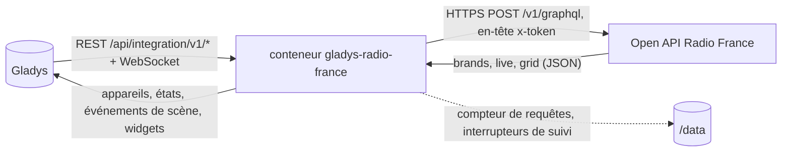
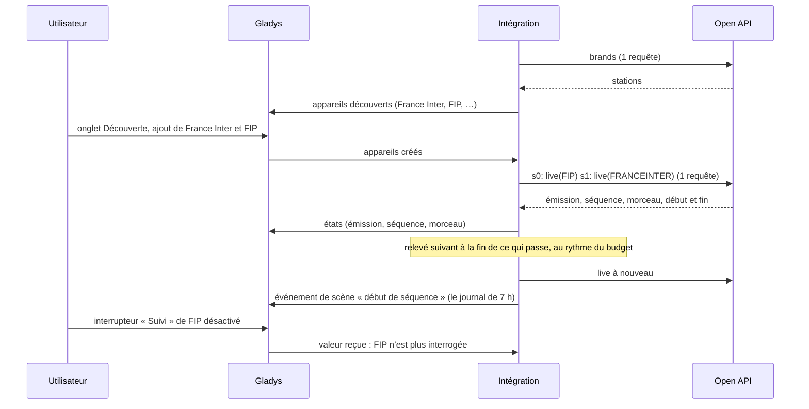
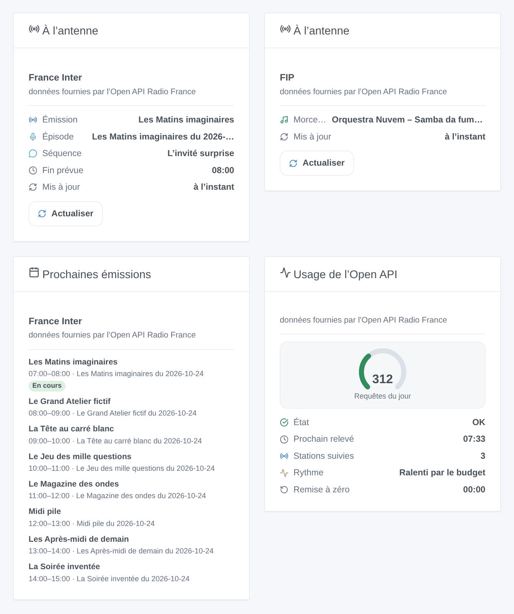

# Gladys Radio France

[English](README.md) · **Français** · [Deutsch](README.de.md) · [Español](README.es.md)

[](LICENSE)
[](https://github.com/William-De71/gladys-radio-france/releases)
[](https://github.com/William-De71/gladys-radio-france/actions/workflows/release.yml)
[](https://gladysassistant.com)


Intégration externe [Gladys Assistant](https://gladysassistant.com) pour les stations de **Radio France** : l’émission, la séquence et le morceau à l’antenne de France Inter, franceinfo, France Culture, France Musique, FIP, Mouv’, des stations locales ICI et des webradios, depuis l’Open API officielle avec votre propre clé. Vos scènes réagissent quand une nouvelle émission, séquence ou un nouveau morceau commence, et votre tableau de bord affiche ce qui passe et ce qui vient.

Documentation utilisateur : [English](docs/en.md) · [Français](docs/fr.md) · [Deutsch](docs/de.md) · [Español](docs/es.md).

**Intégration non officielle, sans lien avec Radio France.** Données fournies par l’Open API Radio France. **Pas encore testée avec une vraie clé** : personne n’en avait lors de l’écriture ; le client est testé contre une fausse API construite d’après la documentation et des projets qui utilisent l’API.

## Fonctionnalités

- **La liste des stations vient de l’API** (aucune liste dans le code) : stations nationales, webradios, stations locales ICI (ex-France Bleu).
- **Un appareil par station** : émission, séquence et morceau à l’antenne (texte), et un interrupteur **Suivi** : seules les stations suivies sont interrogées.
- **Dans le quota** : jusqu’à 10 stations par requête, le relevé suivant quand ce qui passe se termine, un budget quotidien (900 des 1 000 requêtes d’une clé par défaut) réparti sur la journée, une pause jusqu’à minuit (Paris) quand le quota est atteint.
- **3 déclencheurs de scène** (nouveau morceau, début d’émission, début de séquence), **2 actions de scène** (ce qui passe à l’antenne, prochaines émissions avec une phrase à lire) et **3 widgets** (à l’antenne avec un bouton Actualiser, prochaines émissions, usage de l’Open API).
- Respecte les conditions de l’Open API : rien de Radio France stocké, aucun flux lu, aucun logo, le crédit dans chaque widget.
- Quatre langues partout : anglais, français, allemand, espagnol.

## Fonctionnement




De la liste des stations à une scène :



### Transport

`transports: ["cloud"]` : tout part vers `https://openapi.radiofrance.fr/v1/graphql` avec votre clé dans l’en-tête `x-token` (jamais dans l’URL, jamais dans les journaux). Les requêtes indiquent à Radio France quelles stations vous suivez et quand. `/data` ne contient que le compteur de requêtes du jour et les interrupteurs de suivi ; la liste des stations, ce qui passe et les grilles restent en mémoire (une heure au plus), comme l’exigent les conditions de l’Open API.

## Appareils et fonctionnalités

| Fonctionnalité | Type Gladys   | Remarques                                                                                         |
| -------------- | ------------- | ------------------------------------------------------------------------------------------------- |
| Émission       | text          | nom de l’émission à l’antenne ; un tiret s’il n’y en a pas (FIP et ses webradios surtout)         |
| Séquence       | text          | la séquence dans l’émission (journal, chronique, entretien) ; un tiret entre deux                 |
| Morceau        | text          | « Artiste – Titre » sur les stations musicales ; un tiret sinon                                   |
| Suivi          | switch/binary | activé par défaut ; désactivé = la station n’est jamais interrogée ; les scènes peuvent l’activer |

Identifiants externes : `ext:<sélecteur>:station:<id de station en minuscules>` (`fip`, `franceinter`, `francebleu_alsace`…), d’après l’identifiant `StationsEnum` de l’API, jamais son titre.

## Déclencheurs, actions de scène et widgets



Les images sont des **illustrations générées**, dessinées par le vrai code des widgets à partir de programmes inventés, pas des captures d’écran.

**Widgets** : **À l’antenne** (émission, épisode, séquence, morceau, fin, dernier relevé ; bouton **Actualiser**, une requête au plus une fois par minute), **Prochaines émissions** (les prochaines émissions d’après la grille, lue au plus toutes les 15 minutes), **Usage de l’Open API** (jauge des requêtes du jour, état, prochain relevé, stations suivies, heure de remise à zéro).

**Déclencheurs de scène**, pour les stations suivies, une fois par nouvelle étape, jamais au premier relevé après un démarrage, jamais pour une étape commencée depuis plus de 30 minutes, jamais à cause d’une action de scène ou d’un bouton :

| Déclencheur                      | Filtres | Variables                                                       |
| -------------------------------- | ------- | --------------------------------------------------------------- |
| Radio France : nouveau morceau   | station | station, nom de la station, titre, artiste, album, année, label |
| Radio France : début d’émission  | station | station, nom de la station, émission, titre, résumé, URL, fin   |
| Radio France : début de séquence | station | les mêmes que « début d’émission »                              |

**Actions de scène** :

| Action                                  | Champs                   | Sorties                                                   |
| --------------------------------------- | ------------------------ | --------------------------------------------------------- |
| Radio France : ce qui passe à l’antenne | station                  | émission, séquence, titre du morceau, artiste, album, fin |
| Radio France : prochaines émissions     | station, nombre (1 à 10) | phrase à lire, prochaine émission, son heure de début     |

Exemples :

- **Début de séquence** sur France Inter, émission « Le journal de 7h » → monter le volume de l’enceinte de la cuisine.
- **Nouveau morceau** sur FIP → envoyer le titre et l’artiste à la télé en notification.
- **Chaque jour à 19 h** → « prochaines émissions » sur France Culture, puis lire la phrase à voix haute.

## Prérequis

- Gladys Assistant **5.1.0** ou plus récent (widgets et déclencheurs / actions de scène) : les instances plus anciennes ne peuvent pas installer l’intégration.
- Un accès à Internet depuis Gladys.

### Votre clé Open API

Chaque utilisateur a besoin de sa propre clé, gratuite, personnelle et non transférable : créez un compte sur [developers.radiofrance.fr](https://developers.radiofrance.fr), puis **Mon compte → Demander une clé d’API** avec le nom et le but de votre projet. Radio France valide chaque demande à la main et envoie la clé par e-mail, souvent dans la journée.

## Quota et conditions d’utilisation

- **1 000 requêtes par jour et par clé** (CGU, art. 5.3 et 9.1) : Radio France bloque la clé au-delà. L’intégration s’autorise `daily_budget` (900 par défaut), compte chaque requête HTTP (relevés, actions, bouton, widget de programme, test de la clé, liste des stations), garde 5 % pour les actions et les widgets, et s’arrête jusqu’à minuit (Paris) quand le budget est épuisé ou que l’API refuse pour quota.
- Les CGU définissent une requête comme une requête HTTP : l’intégration interroge jusqu’à 10 stations en une seule (alias GraphQL). Que Radio France la compte pour une requête est une hypothèse, tout comme la remise à zéro à minuit, heure de Paris.
- Aucun stockage de données de Radio France (FAQ), aucune lecture de flux ni de podcast (FAQ), aucun usage commercial, données affichées telles quelles (les titres ne sont pas traduits ; les longs sont raccourcis dans les widgets), le crédit « données fournies par l’Open API Radio France » dans chaque widget, aucun logo Radio France (la couverture est un poste de radio générique).

## Installation

- **Depuis le store** : Intégrations → Radio France → Installer.
- **Depuis l’URL du dépôt** : Intégrations → Installer depuis une URL → `https://github.com/William-De71/gladys-radio-france`.
- **Mode développeur** : lancez le conteneur vous-même avec les variables affichées par Gladys (voir Développement).

## Configuration

| Champ                         | Par défaut | Rôle                                                                                                     |
| ----------------------------- | ---------- | -------------------------------------------------------------------------------------------------------- |
| Clé Open API                  | —          | obligatoire, secrète                                                                                     |
| Langue des textes             | Français   | noms des fonctionnalités, états, phrases des actions (Gladys ne transmet pas la langue de l’utilisateur) |
| Budget quotidien (requêtes)   | 900        | 100 à 1 000 ; baissez-le si la clé sert à autre chose                                                    |
| Intervalle minimum (secondes) | 90         | 60 à 600 ; jamais deux relevés plus rapprochés                                                           |

**Tester la clé d’API** (bouton de la configuration) lit la liste des stations (une requête) et affiche les requêtes utilisées aujourd’hui.

## Utilisation

1. Demandez votre clé sur developers.radiofrance.fr et attendez l’e-mail.
2. Installez l’intégration, collez la clé, appuyez sur **Tester la clé d’API**.
3. **Découverte**, puis ajoutez les stations que vous écoutez ; désactivez **Suivi** sur celles que vous ne voulez que dans un widget.
4. Ajoutez les widgets à un tableau de bord ; créez des scènes avec les déclencheurs et les actions.

## Développement

```bash
npm install
npm test                       # node --test, une fausse Open API, jamais le réseau
npm run lint                   # ESLint
npm run format:check           # Prettier
npx github:GladysAssistant/integration-store . --skip-image-check
node scripts/fake-openapi.mjs 8781     # une fausse Open API sur 127.0.0.1, clé test-key-0123456789
scripts/check-simulator.sh     # la vraie intégration en HTTP contre la fausse API, 3 formes de schéma
scripts/build-cover.sh         # cover.jpg depuis docs/assets/cover.svg
docs/illustrations/render.sh   # docs/assets/widgets.<langue>.png
```

En local, le SDK lit `GLADYS_HOST_API_URL`, `GLADYS_INTEGRATION_TOKEN` et `GLADYS_INTEGRATION_SELECTOR` (donnés par Gladys en mode développeur) ; `RADIO_FRANCE_DATA_DIR` déplace `/data` ; `RADIO_FRANCE_OPENAPI_URL=http://127.0.0.1:8781/v1/graphql` fait pointer l’intégration vers la fausse API (seule une adresse locale est acceptée : la clé ne part jamais ailleurs). `DEBUG=gladys-integration-sdk` affiche les journaux du SDK.

Les tests couvrent le client (en-tête `x-token`, alias, identifiants de station, erreurs 401 / 429 / quota / GraphQL / réseau, la clé jamais dans un message), la lecture des réponses (liste des stations, étapes, émissions d’une grille), le planificateur (fin des étapes, plancher, plafond, rythme du budget, minuit à Paris avec les changements d’heure), le compteur dans `/data`, les déclencheurs (transitions, pas au premier relevé, étapes trop anciennes), les actions (sorties déclarées uniquement), les widgets (`validateWidgetContent`), les appareils, le manifeste, les quatre langues, le script de release et toute l’intégration contre le faux Gladys du SDK et la fausse API. `test/structure.test.js` fige toutes les clés que les utilisateurs enregistrent.

## Processus de release


Chaque fusion sur `main` lance la CI, puis calcule la version d’après les [Conventional Commits](https://www.conventionalcommits.org/fr/) depuis le dernier tag : `feat` → mineure, `fix` / `perf` → correctif, `!` ou `BREAKING CHANGE` → majeure (une mineure tant qu’on est sous 1.0.0) ; `docs`, `chore`, `ci`, `test`, `style`, `refactor`, `build` seuls ne publient rien. La section du changelog est générée, le tag poussé, l’image multi-architecture construite, puis `main` reçoit le commit de release, la release GitHub est créée et un dernier job vérifie l’image publique, le validateur du store et le topic.

- Le titre de la pull request devient le commit squash, puis la ligne du changelog : écrivez-le en anglais, pour l’utilisateur (`pr-title.yml` le vérifie). Ne modifiez jamais `CHANGELOG.md` à la main.
- La 1.0.0 est une décision : Actions → Release → Run workflow avec `release-as: 1.0.0`. `dry-run` affiche la version et les notes sans rien publier.
- **Branche protégée** : la release pousse son commit sur `main` avec `GITHUB_TOKEN`. Le ruleset `protect-main` (ni suppression, ni force-push) le laisse passer ; une règle plus stricte (pull request obligatoire, status checks) demanderait d’ajouter GitHub Actions à sa liste de contournement, ou une GitHub App.
- Après la première release, rendez le package `ghcr.io` public (Package settings → Change visibility), sinon Gladys ne peut pas le télécharger.

## Dépannage

Voir [docs/fr.md](docs/fr.md#dépannage). Signalez un problème avec les versions de Gladys et de l’intégration, le message de **Tester la clé d’API** (il n’affiche jamais la clé), le widget « Usage de l’Open API » et les journaux avec `DEBUG=gladys-integration-sdk`. Ne collez jamais votre clé.

## Contribuer

Les issues et pull requests sont les bienvenues. Lancez `npm run format:check && npm run lint && npm test` avant d’ouvrir une pull request, et gardez inchangés les identifiants externes et les clés enregistrées (voir [CLAUDE.md](CLAUDE.md)). Si vous avez une clé, une réponse de la vraie requête `live` (avec des titres inventés si vous préférez) aide plus que tout : le schéma ne se lit pas sans clé.

## Sécurité

Voir [SECURITY.md](SECURITY.md) : signalez les vulnérabilités en privé. La clé est un champ `secret`, envoyée seulement à `openapi.radiofrance.fr` dans un en-tête, jamais journalisée ni écrite dans `/data`.

## Captures à venir

Les images ci-dessus sont des illustrations, pas des captures d’écran. Les vraies captures iront dans `docs/assets/screenshots/` (PNG, 1280 × 800) : `configuration.png` (la clé et les sections d’aide), `discovery.png` (la liste des stations), `device.png` (une station et ses fonctionnalités sur un tableau de bord), `scene-trigger.png` (le déclencheur « début de séquence »), `scene-upcoming.png` (l’action « prochaines émissions » et sa phrase).

## Limites connues

- Jamais testée avec une vraie clé : le schéma exact de la requête `live`, le décompte d’une requête avec alias, l’heure de remise à zéro du quota et les identifiants actuels des stations ICI sont des hypothèses (voir CLAUDE.md). Si l’API refuse la requête `live`, l’intégration se replie sur des formes plus simples, puis sur la grille des programmes.
- Les déclencheurs viennent des relevés réguliers : quelques minutes de retard au pire, et un morceau plus court que l’intervalle peut être manqué.
- Pas d’écoute en direct ni de podcast : l’Open API ne l’autorise pas.
- FIP et ses webradios ne publient pas leur programme à l’avance.

## Licence

[Licence Apache 2.0](LICENSE) — voir aussi [NOTICE](NOTICE). Radio France et les noms de ses stations appartiennent à Radio France ; ce projet n’a aucun lien avec elle. Merci à la documentation et au SDK de Gladys, et aux projets qui ont documenté l’Open API par l’exemple (voir NOTICE).
