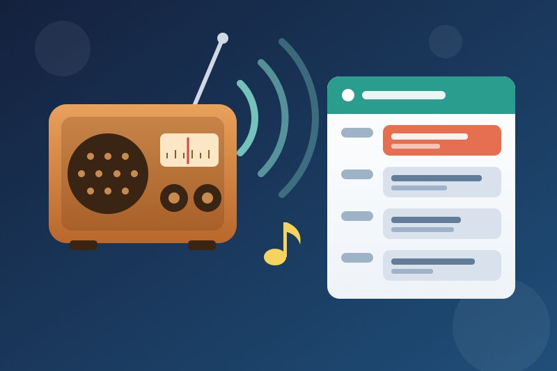
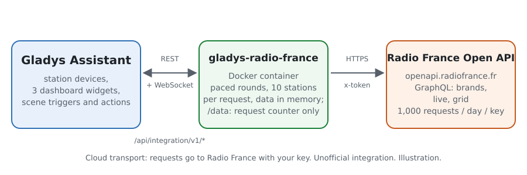
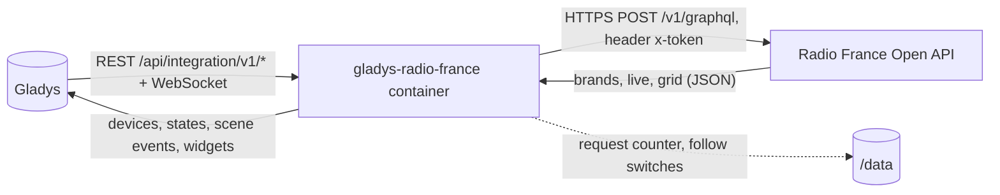
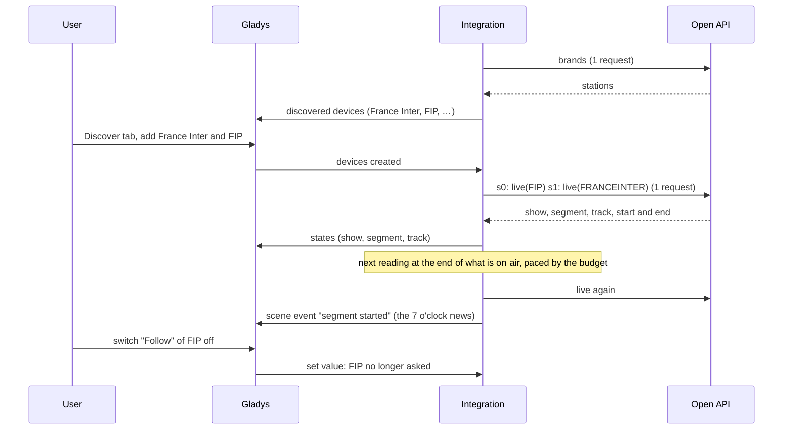
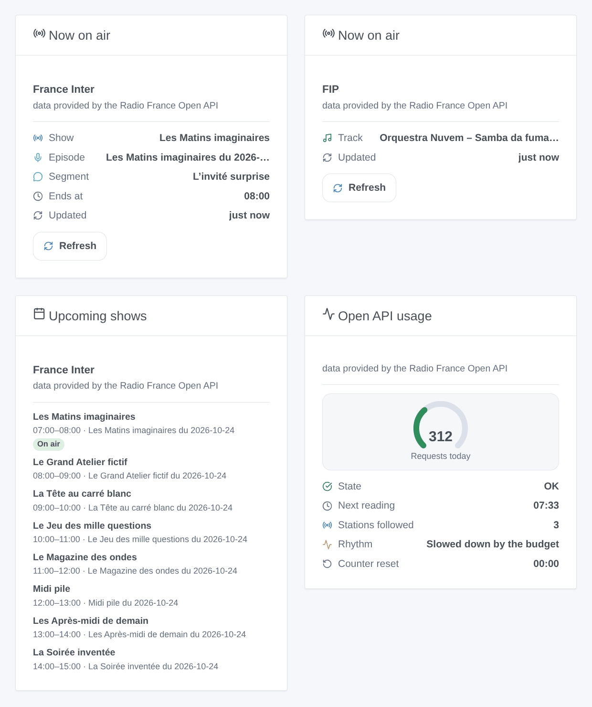

# Gladys Radio France

**English** · [Français](README.fr.md) · [Deutsch](README.de.md) · [Español](README.es.md)

[](LICENSE)
[](https://github.com/William-De71/gladys-radio-france/releases)
[](https://github.com/William-De71/gladys-radio-france/actions/workflows/release.yml)
[](https://gladysassistant.com)



[Gladys Assistant](https://gladysassistant.com) external integration for the **Radio France** stations: the show, the segment and the track on air on France Inter, franceinfo, France Culture, France Musique, FIP, Mouv’, the ICI local stations and the web radios, from the official Open API with your own key. Your scenes can react when a new show, segment or track starts, and your dashboard shows what is on air and what comes next.

User documentation: [English](docs/en.md) · [Français](docs/fr.md) · [Deutsch](docs/de.md) · [Español](docs/es.md).

**Unofficial integration, not affiliated with Radio France.** Data provided by the Radio France Open API (“données fournies par l’Open API Radio France”). **Not tested with a real key yet**: nobody involved had one when it was written; the client is tested against a fake API built from the documentation and from projects that use the API.

## Features

- **The station list from the API** (no list in the code): national stations, web radios, ICI local stations (formerly France Bleu).
- **One device per station**: show, segment and track on air (text), and a **Follow** switch: only followed stations are asked.
- **Within the quota**: up to 10 stations in one request, the next reading when what is on air ends, a daily budget (900 of the 1,000 requests of a key by default) spread over the day, a pause until midnight (Paris) when the quota is reached.
- **3 scene triggers** (new track, show started, segment started), **2 scene actions** (what is on air, upcoming shows with a sentence to read out) and **3 dashboard widgets** (now on air with a Refresh button, upcoming shows, Open API usage).
- Respects the terms of the Open API: nothing of Radio France stored, no stream played, no logo, the credit in every widget.
- Four languages everywhere: English, French, German, Spanish.

## How it works





From the station list to a scene:



### Transport

`transports: ["cloud"]`: everything goes to `https://openapi.radiofrance.fr/v1/graphql` with your key in the `x-token` header (never in the URL, never in the logs). The requests reveal to Radio France which stations you follow and when. `/data` only holds the request counter of the day and the follow switches; the station list, what is on air and the grids stay in memory (an hour at most), as the terms of the Open API require.

## Devices and features

| Feature | Gladys type   | Notes                                                                              |
| ------- | ------------- | ---------------------------------------------------------------------------------- |
| Show    | text          | name of the show on air; a dash when there is none (FIP and its web radios mostly) |
| Segment | text          | the segment inside the show (news, column, interview); a dash between two          |
| Track   | text          | “Artist – Title” on the music stations; a dash otherwise                           |
| Follow  | switch/binary | on by default; off = the station is never asked; scenes can switch it              |

External ids: `ext:<selector>:station:<station id in lower case>` (`fip`, `franceinter`, `francebleu_alsace`…), from the `StationsEnum` id of the API, never its title.

## Scene triggers, actions and widgets



The images are **generated illustrations**, drawn from the real widget code on made-up programs, not screenshots.

**Widgets**: **Now on air** (show, episode, segment, track, end, last reading; **Refresh** button, one request at most once a minute), **Upcoming shows** (the next shows from the program grid, read at most every 15 minutes), **Open API usage** (gauge of the requests of the day, state, next reading, stations followed, reset time).

**Scene triggers**, for followed stations, once per new step, never at the first reading after a start, never for a step that started more than 30 minutes ago, never because of a scene action or a button:

| Trigger                       | Filters | Variables                                                 |
| ----------------------------- | ------- | --------------------------------------------------------- |
| Radio France: new track       | station | station, station name, title, artist, album, year, label  |
| Radio France: show started    | station | station, station name, show, title, summary, URL, ends at |
| Radio France: segment started | station | the same as “show started”                                |

**Scene actions**:

| Action                       | Fields                    | Outputs                                            |
| ---------------------------- | ------------------------- | -------------------------------------------------- |
| Radio France: what is on air | station                   | show, segment, track title, artist, album, ends at |
| Radio France: upcoming shows | station, number (1 to 10) | sentence to read out, next show, its start time    |

Examples:

- **Segment started** on France Inter, show “Le journal de 7h” → raise the volume of the kitchen speaker.
- **New track** on FIP → send the title and the artist to the TV as a notification.
- **Every day at 7 pm** → “upcoming shows” on France Culture, then read the sentence out loud.

## Requirements

- Gladys Assistant **5.1.0** or later (dashboard widgets and scene triggers / actions): older instances cannot install the integration.
- Internet access from Gladys.

### Your Open API key

Each user needs their own key, free, personal and non-transferable: create an account on [developers.radiofrance.fr](https://developers.radiofrance.fr), then **My account → Request an API key** with the name and the purpose of your project. Radio France validates each request by hand and sends the key by e-mail, often within the day.

## Quota and terms of use

- **1,000 requests a day per key** (terms of use, art. 5.3 and 9.1): Radio France blocks the key past it. The integration allows itself `daily_budget` (900 by default) and counts every HTTP request (rounds, actions, button, schedule widget, key test, station list), keeps 5 % for the actions and widgets, and stops until midnight (Paris) when it is used up or when the API refuses for quota.
- The terms define a request as an HTTP request: the integration asks up to 10 stations in one (GraphQL aliases). That Radio France counts it as one request is an assumption, as is the reset at midnight in Paris.
- No storage of Radio France data (FAQ), no stream or podcast playback (FAQ), no commercial use, data shown as it is (titles are not translated; long ones are shortened in the widgets), the credit “données fournies par l’Open API Radio France” in each widget, no Radio France logo (the cover is a generic radio set).

## Installation

- **From the store**: Integrations → Radio France → Install.
- **From the repository URL**: Integrations → Install from a URL → `https://github.com/William-De71/gladys-radio-france`.
- **Developer mode**: run the container yourself with the variables Gladys shows (see Development).

## Configuration

| Field                      | Default | Meaning                                                                                      |
| -------------------------- | ------- | -------------------------------------------------------------------------------------------- |
| Open API key               | —       | required, secret                                                                             |
| Language of the texts      | French  | feature names, statuses, sentences of the actions (Gladys does not tell the user's language) |
| Daily budget (requests)    | 900     | 100 to 1,000; lower it if the key serves something else                                      |
| Minimum interval (seconds) | 90      | 60 to 600; never two readings closer than this                                               |

**Test the API key** (configuration button) reads the station list (one request) and shows the requests used today.

## Usage

1. Request your key on developers.radiofrance.fr and wait for the e-mail.
2. Install the integration, paste the key, press **Test the API key**.
3. **Discover**, then add the stations you listen to; switch **Follow** off on those you only want in a widget.
4. Add the widgets to a dashboard; build scenes with the triggers and the actions.

## Development

```bash
npm install
npm test                       # node --test, a fake Open API, never the network
npm run lint                   # ESLint
npm run format:check           # Prettier
npx github:GladysAssistant/integration-store . --skip-image-check
node scripts/fake-openapi.mjs 8781     # a fake Open API on 127.0.0.1, key test-key-0123456789
scripts/check-simulator.sh     # the real integration over HTTP against the fake API, 3 schema shapes
scripts/build-cover.sh         # cover.jpg from docs/assets/cover.svg
docs/illustrations/render.sh   # docs/assets/widgets.<lang>.png
```

Locally, the SDK reads `GLADYS_HOST_API_URL`, `GLADYS_INTEGRATION_TOKEN` and `GLADYS_INTEGRATION_SELECTOR` (given by Gladys in developer mode); `RADIO_FRANCE_DATA_DIR` moves `/data`; `RADIO_FRANCE_OPENAPI_URL=http://127.0.0.1:8781/v1/graphql` points the integration at the fake API (only a local address is accepted: the key never goes elsewhere). `DEBUG=gladys-integration-sdk` shows the SDK logs.

The tests cover the client (`x-token` header, aliases, station ids, 401 / 429 / quota / GraphQL / network errors, the key never in a message), the parsing of the answers (station list, steps, shows of a grid), the scheduler (end of the steps, floor, ceiling, pace of the budget, midnight in Paris with the clock changes), the counter in `/data`, the triggers (transitions, not at the first reading, stale steps), the actions (declared outputs only), the widgets (`validateWidgetContent`), the devices, the manifest, the four languages, the release script, and the whole integration against the fake Gladys of the SDK and the fake API. `test/structure.test.js` freezes every key users store.

## Release process


Every merge on `main` runs the CI, then computes the version from the [Conventional Commits](https://www.conventionalcommits.org/) since the last tag: `feat` → minor, `fix` / `perf` → patch, `!` or `BREAKING CHANGE` → major (a minor below 1.0.0); `docs`, `chore`, `ci`, `test`, `style`, `refactor`, `build` alone publish nothing. The changelog section is generated, the tag pushed, the multi-architecture image built, then `main` receives the release commit, the GitHub Release is created and a last job checks the public image, the store validator and the topic.

- The pull request title becomes the squash commit, then the changelog line: write it in English, for the user (`pr-title.yml` checks it). Never edit `CHANGELOG.md` by hand.
- 1.0.0 is a decision: Actions → Release → Run workflow with `release-as: 1.0.0`. `dry-run` shows the version and the notes without publishing.
- **Protected branch**: the release pushes its commit to `main` with `GITHUB_TOKEN`. The `protect-main` ruleset (no deletion, no force-push) lets it through; a stricter rule (pull request required, status checks) would need GitHub Actions in its bypass list, or a GitHub App.
- After the first release, make the `ghcr.io` package public (Package settings → Change visibility), or Gladys cannot pull it.

## Troubleshooting

See [docs/en.md](docs/en.md#troubleshooting). Report issues with the versions of Gladys and of the integration, the message of **Test the API key** (it never shows the key), the “Open API usage” widget and the logs with `DEBUG=gladys-integration-sdk`. Never paste your key.

## Contributing

Issues and pull requests are welcome. Run `npm run format:check && npm run lint && npm test` before opening a pull request, and keep every external id and stored key unchanged (see [CLAUDE.md](CLAUDE.md)). If you have a key, an answer of the real `live` query (with made-up titles if you prefer) helps more than anything: the schema cannot be read without a key.

## Security

See [SECURITY.md](SECURITY.md): report vulnerabilities privately. The key is a `secret` field, sent only to `openapi.radiofrance.fr` in a header, never logged nor written to `/data`.

## Screenshots to come

The images above are illustrations, not screenshots. Real screenshots will go in `docs/assets/screenshots/` (PNG, 1280 × 800): `configuration.png` (the key and the help sections), `discovery.png` (the station list), `device.png` (a station with its features on a dashboard), `scene-trigger.png` (the “segment started” trigger), `scene-upcoming.png` (the “upcoming shows” action and its sentence).

## Known limits

- Never tested with a real key: the exact schema of the `live` query, the counting of a request with aliases, the reset hour of the quota and the current ids of the ICI stations are assumptions (see CLAUDE.md). If the API refuses the `live` query, the integration falls back to simpler shapes, then to the program grid.
- Triggers come from regular readings: a few minutes late at worst, and a track shorter than the interval can be missed.
- No live listening, no podcast: not allowed by the Open API.
- FIP and its web radios do not publish their schedule in advance.

## License

[Apache License 2.0](LICENSE) — see also [NOTICE](NOTICE). Radio France and the names of its stations belong to Radio France; this project is not affiliated with it. Thanks to the Gladys documentation and SDK, and to the projects that documented the Open API by example (see NOTICE).
